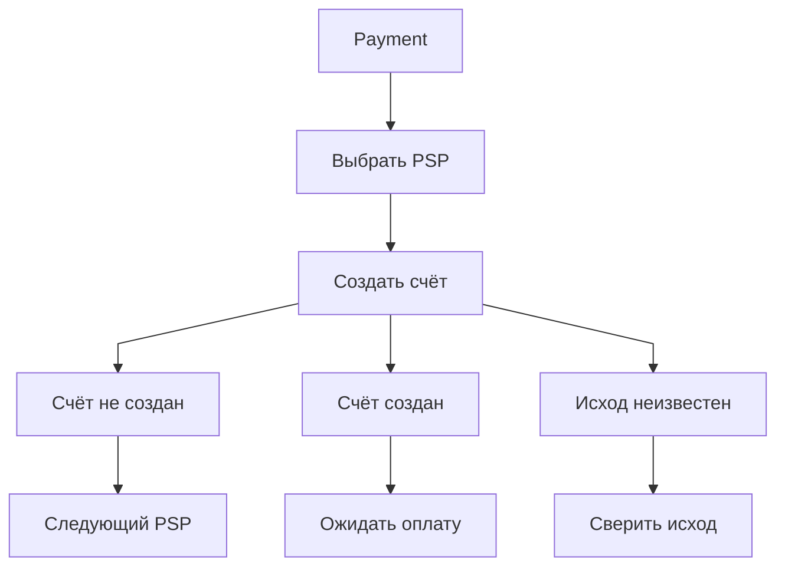

# Billing

## Назначение

Billing — ограниченный контекст (DDD) приёма платежей. Он владеет моделью [Payment и его попыток](architecture/domain/payment.md): фиксирует платёж по покупке, взаимодействует с провайдерами (PSP) и принимает решение по полученным денежным фактам.

## Цель

Каскад позволяет выбрать следующего PSP, если текущий недоступен до отправки либо доказано не создал счёт. При неизвестном результате Billing сначала выясняет судьбу исходного запроса: второй счёт может привести к повторной оплате. [Гарантии и границы отказов](architecture/guarantees.md).

## Каскад

[Политика маршрутизации](architecture/routing/policy.md) формирует порядок допущенных PSP для Payment. Исполнитель выбирает следующую пригодную запись сохранённого маршрута; добавление провайдера не меняет платёжную модель.

Переход к следующему PSP требует [доказанного безопасного отказа](architecture/routing/cascade.md). Созданный счёт остаётся у своего провайдера; поступление проверяется через [сценарий подтверждения оплаты](architecture/flows/settlement.md). Неизвестный исход обрабатывает [сверка](architecture/flows/reconciliation.md), без автоматического создания нового счёта.

## Контекст

Рассматривается приём криптоплатежей для adult AI-платформы. Доступные активы, сети и PSP зависят от конфигурации и допуска конкретного бизнеса. [Границы и допущения](architecture/context.md).

## Содержание

| Раздел | Что внутри |
|---|---|
| [Архитектура](architecture/README.md) | Граница Billing и гарантии → агрегат Payment → процессы и контракты → хранение, фоновая обработка и структура кода. |
| [Развитие](roadmap/README.md) | Рекомендуемый запуск, монолит с общей или отдельной БД, микросервис Billing; условия выбора и безопасная миграция. |
| Эксплуатация | [Метрики](operations/metrics.md), [нагрузка](operations/capacity.md), [восстановление](operations/recovery.md) и [проверки отказов](operations/verification.md). |
| [Решения](decisions/README.md) | Основания исходного выбора, [альтернативы](decisions/alternatives.md) и условия пересмотра. |
| [Глоссарий](reference/glossary.md) | Термины, используемые в платёжных документах. |

## Реализация по спецификации

Для каждой задачи реализации указываются исходный сценарий из [архитектуры](architecture/README.md), его контракт и инварианты, а также проверяемый исход из [проверок гарантий](operations/verification.md). Задачи и код уточняют реализацию этих правил; открытые условия продукта и контракт конкретного PSP согласуются до реализации зависящего от них поведения. Изменение правила сначала отражается в соответствующем документе, затем в связанных проверках и коде.
