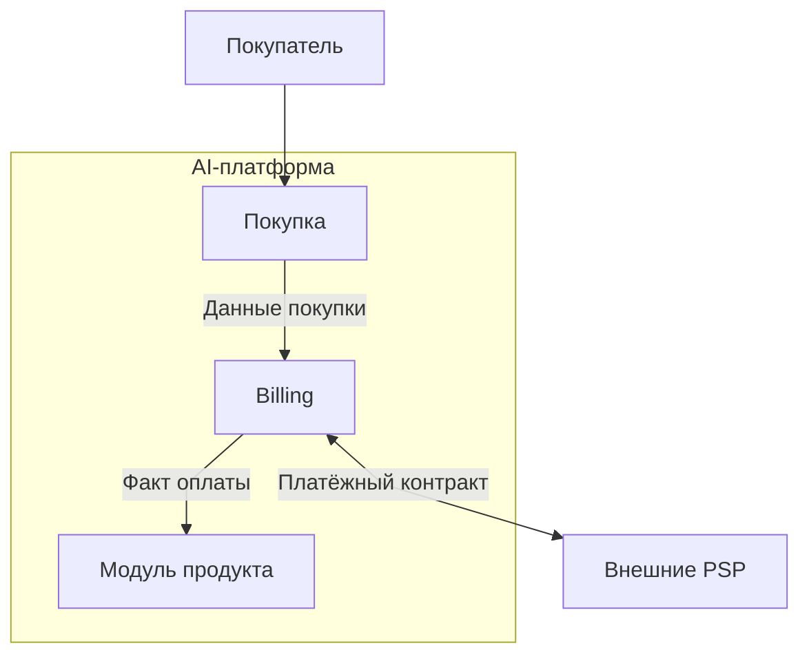

# Контекст и граница Billing

[Billing](../README.md) → [Архитектура](README.md)

Billing — ограниченный контекст (DDD), который ведёт Payment от запроса на оплату до проверенного денежного результата. Он выбирает допущенного провайдера, хранит попытки и полученные наблюдения, принимает решение о статусе оплаты. Цена и предмет покупки определяются вне Billing; доступ к оплаченной покупке предоставляет модуль продукта.

## Граница системы

Блоки внутри платформы показывают ответственность, а не число сервисов или модулей. Стрелка к модулю продукта обозначает передачу подтверждённого факта оплаты; она не задаёт транспорт или общую транзакцию. Покупку и предоставление доступа может обрабатывать один модуль продукта; результат предоставления не принадлежит агрегату Payment.

## Ответственность и данные

| Участник | Чем владеет | Обмен с Billing |
|---|---|---|
| Модуль продукта | Покупатель, предмет, цена и условия покупки; право доступа или иной результат покупки | Передаёт доверенные идентификатор и снимок условий; по проверенному факту оплаты предоставляет результат покупки один раз. Billing не пересчитывает цену из клиентского запроса. |
| Billing | Payment, попытки, маршрут, наблюдения PSP и решение об оплате | Возвращает реквизиты и статус; после проверки фиксирует факт оплаты для модуля продукта. |
| PSP | Платёжные реквизиты, собственные статусы и наблюдение переводов | Получает запрос на создание счёта; сообщает состояние и фактические данные платежа по своему контракту. |

Покупатель отправляет средства по реквизитам PSP. В рассматриваемой конфигурации Billing не хранит приватные ключи и не наблюдает блокчейн самостоятельно; достоверность и полнота сведений PSP проверяются в пределах его доступного контракта. Это ограничение влияет на [гарантии](guarantees.md) и процедуры сверки.

## Допущения и открытые параметры

Рассматривается приём криптоплатежей для adult AI-платформы. Это контекст решения, а не ограничение модели Billing одним активом, сетью или провайдером. PSP включается в маршрут только после допуска конкретного бизнеса и проверки его платёжных возможностей. Карточный приём, возвраты и выплаты требуют отдельных контрактов.

| Нужно определить для действующего проекта | На что влияет |
|---|---|
| Источник достоверной цены и уникальный идентификатор покупки | Снимок условий Payment и идемпотентность checkout. |
| Доступные активы, сети, география и merchant accounts | Допуск PSP и состав маршрута. |
| Правила частичной, избыточной и поздней оплаты | Денежное решение и операторский разбор. |
| Способ выдачи и граница её транзакции | Локальное исполнение или надёжная асинхронная доставка. |
| Требования к восстановлению и доступная история PSP | Сроки сверки, хранения и реакция на неопределённые результаты. |

Ни один из этих параметров не выводится из названия PSP или выбранного стека: его фиксируют в контракте продукта и настройке конкретной интеграции.

Billing не создаёт новое намерение на покупку и не меняет `purchase_id`. Порядок повтора после `FAILED` или `EXPIRED` и ответственность модуля продукта описаны в [состояниях](domain/states.md) и [денежных исключениях](flows/exceptions.md).
