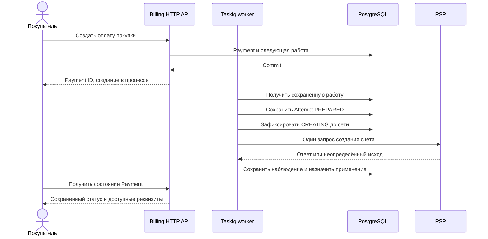

# Создание оплаты

[Billing](../../README.md) → [Архитектура](../README.md) → Сценарии

Checkout принимает намерение оплатить покупку и выдаёт реквизиты только после их сохранения и проверки. Клиент передаёт идентификатор покупки и ключ повтора; цену, маршрут и получателя денег он не задаёт.

## Последовательность

Диаграмма разделяет HTTP API и worker: создание счёта выполняется в фоне после commit Payment, независимо от доставки ответа клиенту. Worker может начать работу до того, как клиент получит HTTP-ответ. Redis/Taskiq сигнализируют о сохранённой в PostgreSQL работе; потерянный сигнал не отменяет её, scanner может найти её снова. Ответ PSP сохраняется как наблюдение, затем отдельная фоновая работа применяет его по [правилам подтверждения](settlement.md). Клиентское чтение получает локальное состояние Billing и не вызывает PSP.

## Принятие команды

1. Проверить право покупателя на покупку и её достоверный снимок у владельца покупки.
2. Обработать повтор **до** чтения текущей цены. Совпавшее первоначальное намерение возвращает сохранённый Payment; конфликт и конкуренция решаются по [правилам идемпотентности](../consistency.md).
3. Для новой оплаты сохранить Payment с ценой и предметом покупки, версией и порядком [маршрута](../routing/policy.md), сроком новых попыток и обнаружимой следующей работой. Attempt ещё нет.
4. Ответить с Payment ID после commit. Реквизиты появятся в локальном статусе только после проверки и сохранения ответа PSP.

## Создание счёта

Исполнитель выбирает допустимого PSP из сохранённого маршрута, затем под защитой Payment резервирует `PREPARED`. Единоличный переход в `CREATING` фиксируется до сетевого вызова. Ответ PSP проходит через [общее применение наблюдений](settlement.md): успешные реквизиты проверяются против снимка покупки и исходного запроса, затем становятся доступными клиенту.

До отправки недоступный PSP можно пропустить без Attempt. После отправки исходы и право перейти дальше определяет [безопасный каскад](../routing/cascade.md). Если запрос мог исполниться, но ответ потерян, Payment остаётся в процессе [сверки](reconciliation.md), а новый счёт автоматически не создаётся.

После `FAILED` или `EXPIRED` этот сценарий не создаёт второй Payment для того же `purchase_id`. Возобновление покупки относится к [правилам состояний](../domain/states.md), а поздние деньги по старому счёту — к [денежным исключениям](exceptions.md).
