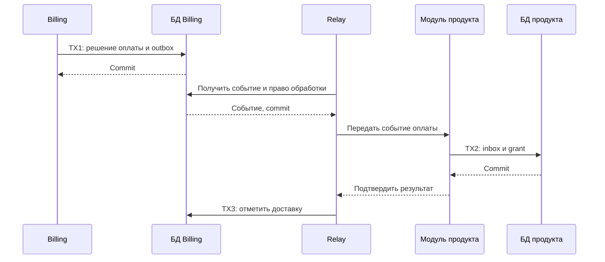

# Оплата и предоставление покупки

[Billing](../../README.md) → [Архитектура](../README.md) → Сценарии

[Подтверждение оплаты](settlement.md) определяет, когда Billing вправе сохранить `PAID`. Здесь описано, как с этим решением связано предоставление оплаченной покупки. Например, Billing подтверждает платёж за контент, а модуль продукта сохраняет право пользователя просматривать его. Таблицы прав доступа принадлежат модулю продукта; Billing вызывает его операцию и не изменяет эти таблицы напрямую.

Результат покупки, например право доступа, далее обозначается `grant`. Он не означает завершённую генерацию или доставку медиа. Модуль продукта защищает результат уникальностью `(tenant_id, purchase_id)`, независимо от числа сообщений об оплате. Повтор с несовместимыми параметрами покупки требует разбора, а не успешного подтверждения. Дальнейшие операции продукта остаются за пределами Billing.

## Общая SQL-транзакция

В [монолите с общей БД](../../roadmap/modular-monolith-shared-db.md) фоновый обработчик может сохранить оплату и результат покупки одним commit.

| Условие | Требование к исполнению |
|---|---|
| Одна PostgreSQL БД | Payment и результат покупки могут находиться в разных схемах, но доступны через одно подключение. |
| Одна физическая транзакция | Репозитории Billing и адаптер `FulfillmentProtocol` используют общую session/UoW с одним соединением. Одинаковый DSN при разных session этого не обеспечивает. |
| Один commit | Операция модуля продукта не делает собственного commit/rollback. Транзакцию завершает координирующая UoW; `flush` не означает commit. |
| Только транзакционные записи | В операции нет HTTP, записи в S3, вызова AI/GPU или публикации сообщения. Для последующей внешней работы модуль продукта сохраняет собственное обязательство. |

Одним commit фиксируются результат Attempt, `Payment.PAID`, аудит, применение наблюдения PSP и grant через операцию модуля продукта. При ошибке откатывается весь этот результат. Исходное наблюдение, принятое ранее, остаётся в БД для нового применения; rollback не отменяет перевод денег у PSP.

Если ответ на commit потерян, исполнитель перечитывает сохранённое состояние. Падение после commit, но до ACK Taskiq приводит к повторной задаче без нового grant. Постоянная ошибка модуля продукта задерживает и сохранение `PAID`; такой случай обнаруживается по возрасту ожидающего наблюдения и требует разбора. Повторная оплата не является способом восстановления.

Сессию связывает инфраструктурная сборка, не домен Payment и не публичный DTO. Один объект SQLAlchemy Session с несколькими Engine также не обеспечивает общий commit: без специального протокола это [некоординированные транзакции соединений](https://docs.sqlalchemy.org/en/20/orm/session_basics.html#committing).

## Раздельные SQL-транзакции

При разных БД или сетевом вызове Billing и модуль продукта фиксируют результаты независимо. Такой способ допустим и при общей БД, если ошибки предоставления покупки не должны задерживать сохранение принятой оплаты.

**Outbox** — сообщения о принятой оплате, сохранённые Billing вместе с `PAID`. **Relay** — фоновый обработчик их доставки. **Inbox** — записи обработанных сообщений у модуля продукта; он сохраняет их вместе с результатом покупки.

Обозначения БД показывают принадлежность данных: физическая БД может быть общей, транзакции остаются разными. В монолите relay вызывает локальную операцию продукта с новой UoW; между приложениями используется аутентифицированный HTTP. Транзакция Billing закрыта до передачи сообщения. Redis/Taskiq доставляют ID работы, а само обязательство остаётся в PostgreSQL.

### Сохранение и подтверждение

| Запись | Что сохраняется |
|---|---|
| Billing, TX1 | Результат Attempt, `PAID`, аудит, применение наблюдения и `billing.outbox_events` с постоянным event ID. Уникальность одного обязательства данного вида на Payment исключает новое событие при повторном применении. |
| Outbox | Версия формата, tenant, purchase ID, Payment ID и сведения о принятой оплате, необходимые получателю; срок следующей доставки, попытки и подтверждение. Секреты PSP и raw payload в сообщение не входят. |
| Модуль продукта, TX2 | Event ID в пространстве источника и уникальный grant по покупке. Совпадающий дубль возвращает прежний результат; несовместимые параметры требуют разбора. |
| Billing, TX3 | Подтверждение результата для этого event ID. До него событие остаётся повторно доставляемым. |

Успешный ответ получателя означает commit **inbox и grant**. HTTP `202`, приём в память или запись только в Redis этим подтверждением не являются. Отдельная стадия исполнения после приёма потребовала бы другого контракта подтверждения результата; здесь она не предполагается.

### Повторы и восстановление

| Сбой | Продолжение |
|---|---|
| Доставка не дошла до commit модуля продукта | Сохранённый outbox остаётся для повтора. |
| Grant сохранён, но ответ потерян или relay упал до TX3 | Повторяется тот же event ID; inbox и уникальность покупки исключают второй результат. |
| Истёк lease relay и начались две доставки | Получатель защищает результат независимо от числа исполнителей. |
| Redis недоступен или сигнал потерян | Поиск незавершённой работы в PostgreSQL повторно публикует ID после восстановления. |
| Исчерпаны автоматические повторы | Случай передаётся на разбор; обязательство не удаляется и `PAID` не откатывается. |

Срок хранения подтверждений и ключей дедупликации должен покрывать разрешённые повторы и восстановление. Возраста строки недостаточно для безопасного удаления. Inbox продукта отличается от `provider_observations`: первый защищает результат покупки, второй сохраняет исходные сведения PSP в Billing.

## Выбор способа сохранения

Общая транзакция убирает отдельную доставку между модулями, но связывает принятие оплаты с доступностью операции продукта. Раздельные транзакции позволяют продолжать сохранять `PAID` при сбое предоставления покупки; цена — повторяемая доставка и промежуток между оплатой и результатом. В этот промежуток пользователь ожидает покупку, повторный платёж не предлагается. Состояние предоставления покупки хранится отдельно от Payment.

[Transactional outbox](https://docs.aws.amazon.com/prescriptive-guidance/latest/cloud-design-patterns/transactional-outbox.html) закрывает разрыв между commit оплаты и передачей сообщения. Единственный вызов или публикация после commit могут потеряться при падении; вызов до commit допускает предоставление покупки при последующем rollback Billing. Распределённый 2PC не выбран: для этой границы используются локальные транзакции и идемпотентная доставка. Условие выбора — продукт допускает задержку предоставления покупки; её бюджет требуется согласовать и проверить по измерениям. Relay работает на существующих Taskiq workers; отдельный брокер или CDC для этого решения не требуются.

[Хранение](../persistence.md) описывает таблицы и ограничения, [фоновая обработка](../processing.md) — запуск и восстановление работы, [нагрузка](../../operations/capacity.md) — измерение задержек, [миграция](../../roadmap/migration.md) — смену выбранной границы.
