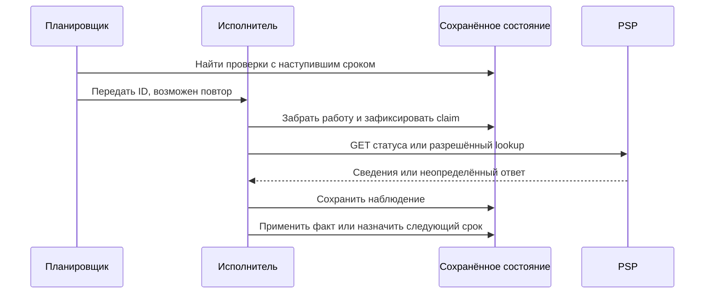

# Сверка с провайдером

[Billing](../../README.md) → [Архитектура](../README.md) → Сценарии

Сверка выясняет исход создания счёта и восполняет пропущенные сведения о переводе. Её запускают сохранённые сроки проверки, а не клиентский GET: клиент читает локальный Payment. Отсутствие webhook не является отсутствием денег.

## Исполнение

Исполнитель не держит транзакцию БД во время внешнего GET. Планировщик только находит сохранённую работу и передаёт ID; потеря сообщения не удаляет срок из долговременного состояния. Новый ответ PSP применяется через тот же [путь наблюдений](settlement.md), что и webhook. Уже сохранённое `PENDING` наблюдение сначала пробуют применить без лишнего запроса к PSP.

## Действие по состоянию

| Состояние | Что проверяется |
|---|---|
| `CREATING` без ответа после сбоя | Исход считается неизвестным; другой исполнитель не повторяет `POST`. |
| `CREATE_UNKNOWN`, внешний ID известен | Аутентифицированный GET в нужном PSP/account/environment. |
| `CREATE_UNKNOWN`, ID неизвестен | Только документированный поиск по merchant reference, отчёт PSP или поддержка; пустой результат сам по себе не разрешает новый счёт. |
| `INVOICE_UNVERIFIED` | По известному ID уточнить котировку и реквизиты; до проверки не показывать счёт и не переходить к следующему PSP. |
| `AWAITING_PAYMENT`, `PARTIALLY_PAID`, `CONFIRMING` | Статус и фактические денежные поля по допустимому графику проверок. |
| Уже `PAID` или счёт `EXPIRED`, появилось новое свидетельство денег | Сохранить и сопоставить новое наблюдение; статус не служит фильтром для его удаления. |

При неизвестном создании необходима гарантия, исключающая как уже существующий счёт, так и позднюю отправку исходного запроса. Истечение времени, lease или отрицательный поиск не дают такой гарантии. Переход к следующему PSP остаётся под правилами [каскада](../routing/cascade.md). В опубликованном [API NOWPayments](../providers/nowpayments.md) GET требует `payment_id`, а фильтр списка по `order_id` не документирован: автоматическое разрешение неизвестного создания без внешнего ID здесь не обещается.

Временная недоступность PSP назначает следующую проверку с ограниченным backoff и бюджетом запросов для конкретного account. Исчерпание автоматических попыток переводит случай в назначенный разбор, а не в `CREATE_REJECTED`. Периодическая сверка истории PSP полезна для обнаружения неизвестных локально поступлений, если account и API дают полный проверяемый отчёт; её покрытие нельзя предполагать заранее.
