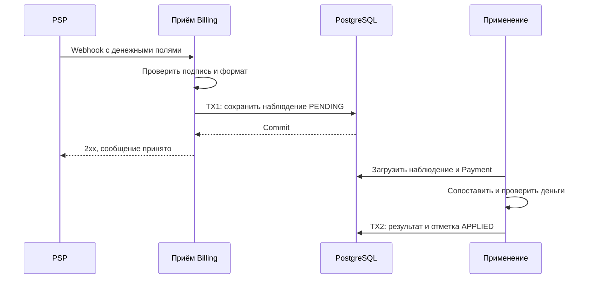

# Подтверждение оплаты

[Billing](../../README.md) → [Архитектура](../README.md) → Сценарии

Webhook, ответ создания счёта и аутентифицированный GET поставляют наблюдения о платеже. Приём внешнего сообщения и решение `PAID` — разные действия: сначала факт сохраняется, затем сопоставляется с Payment и условиями покупки.

## Приём и применение

Для GET и ответа создания источник проверяется по аутентифицированному соединению; их результат также сохраняется до применения. Webhook получает `2xx` после commit TX1, а не после выдачи покупки. Если сохранение не удалось или исход commit неизвестен, успешный ответ PSP не отправляется: повторная доставка безопасна по [правилам идемпотентности](../consistency.md). Отказ TX2 оставляет исходное наблюдение доступным для нового применения.

## Денежная проверка

| Проверка | Что требуется установить |
|---|---|
| Привязка | PSP, merchant account, среда, внешний ID и ссылка на Attempt относятся к этому Payment. |
| Исходная цена | Цена и валюта в запросе PSP и его котировке соответствуют сохранённой покупке. |
| Реквизиты и котировка | Сумма к оплате, актив, сеть и адрес принадлежат проверенному счёту нужной Attempt. |
| Поступление | Фактические актив, сеть и сумма достаточны по согласованным условиям; достигнута требуемая финальность PSP. |
| Время и противоречия | Позднее поступление и несовместимые данные обработаны по [правилам исключений](exceptions.md). |

Подпись подтверждает источник webhook, но не правильность цены или достаточность денег. Статус провайдера тоже не заменяет проверку: например, [NOWPayments](../providers/nowpayments.md) допускает настройки, при которых `finished` не доказывает оплату ожидаемой суммы. Если данных недостаточно, наблюдение остаётся ожидающим сверки; клиенту не сообщается о подтверждённой оплате.

## Атомарная граница

При положительном решении одна локальная транзакция фиксирует результат Attempt, Payment `PAID`, аудит решения, отметку применения наблюдения и **либо** однократный локальный результат покупки, **либо** обязательство передать факт оплаты модулю продукта. Первый способ подходит при общей транзакции модулей; второй — при раздельных транзакциях, в том числе выбранных со старта. Модуль продукта отдельно защищает предоставление покупки ключом покупки. Детали находятся в [оплате и предоставлении покупки](payment-to-product.md).

Нефинальное наблюдение может изменить состояние ожидания и назначить следующую проверку, но не включает выдачу. После `PAID` новые внешние факты сохраняются: точный дубль не создаёт нового эффекта, дополнительное или противоречивое поступление открывает разбор, не откатывая принятое решение.
