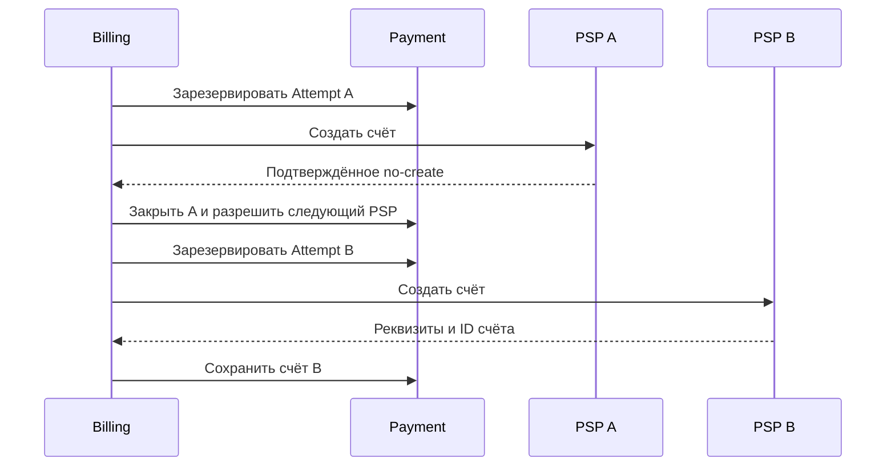

# Безопасный каскад

[Billing](../../README.md) → [Архитектура](../README.md) → [Политика маршрутизации](policy.md)

Каскад выбирает следующий PSP для **того же Payment**, когда предыдущий не создал счёт и больше не может создать его из уже начатого запроса. Порядок кандидатов задаёт политика; каскад решает, можно ли продолжать после исхода Attempt.

## Последовательность безопасного перехода

Схема показывает один безопасный участок маршрута; после B могут следовать C и другие PSP при таких же условиях. Отказ A и продолжение работы сохраняются вместе, чтобы падение между провайдерами не потеряло следующий шаг. Перед внешним вызовом фиксируется маркер `CREATING`: после его сохранения исполнитель уже не может сделать вывод «запрос точно не ушёл» только из состояния БД.

## Решение по исходу

| Ситуация | Действие |
|---|---|
| PSP недоступен или отключён до резервирования Attempt | Записать причину пропуска и рассмотреть следующего кандидата. |
| Доказано, что отправки не было, либо PSP окончательно подтвердил no-create и отсутствие позднего исполнения | Закрыть Attempt как `CREATE_REJECTED`; продолжить маршрут, если ещё не истёк срок новых create. |
| Запрос некорректен для покупки, актива или бизнеса | Остановить создание; смена PSP не исправляет условия команды. |
| Счёт создан | Сохранить ID, котировку и реквизиты; ждать и сверять оплату у этого PSP. |
| Создание могло выполниться, но достоверного ответа нет | `CREATE_UNKNOWN`: не повторять `POST`, не переходить к следующему PSP; начать сверку и при необходимости разбор. |
| Существующий счёт истёк или PSP сообщил об ошибке его оплаты | Продолжить обработку поздних поступлений; автоматический fallback не разрешён. |
| Маршрут исчерпан без созданного или неопределённого счёта | Прекратить новые попытки и зафиксировать неуспех оплаты. |

Timeout, `5xx`, потеря webhook, пустой поиск и истечение lease не доказывают no-create. Даже отрицательный поиск опасен, если исходный исполнитель ещё может отправить запрос позже. Разрешение продолжить требует доказательства, охватывающего и уже созданный счёт, и возможное позднее исполнение операции. Для [NOWPayments](../providers/nowpayments.md) автоматическое снятие `CREATE_UNKNOWN` на основании опубликованного API не предусмотрено.

Операционный deadline прекращает **новые** create, но не превращает `CREATE_UNKNOWN` в отказ и не прекращает проверку денег на ранее выданные реквизиты. Неожиданное поступление от старого PSP сохраняется для разбора, даже если Payment уже оплачен через другой маршрут; повторной выдачи нет. Состояния обеих сущностей приведены в [модели переходов](../domain/states.md).

`CascadePolicy` выражает условия безопасного продолжения, `AdvancePaymentCascadeUseCase` применяет их к сохранённой Attempt и назначает следующую работу. Агрегат Payment проверяет право добавить новую Attempt; ответственность сценариев показана в [контракте application](../contracts/application.md).
