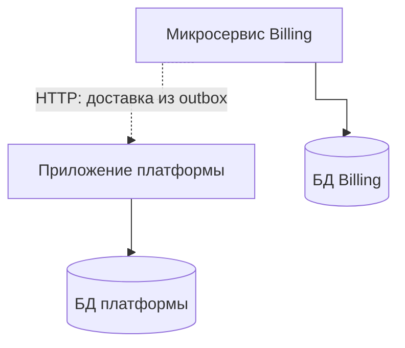

# Микросервис Billing

[Billing](../README.md) → [Развитие](README.md) → Микросервис Billing

Billing становится отдельным приложением со своей БД. Его новую версию можно развернуть или откатить независимо от деплоя платформы при совместимых контрактах и схеме данных. API, workers, scanner и relay принадлежат приложению Billing; его процессы получают собственные секреты и права. Остальная платформа может оставаться модульным монолитом.

## Границы приложений

Прямоугольники обозначают отдельные приложения, сплошные стрелки — SQL-доступ каждого к своей БД. Пунктир показывает доставку outbox-события фоновым relay по HTTP после commit Billing. Получатель подтверждает результат после сохранения inbox и покупки; затем relay отмечает доставку. На схеме выделена эта граница: клиентские запросы, получение снимка покупки и обмен с PSP описаны в [контрактах](../architecture/contracts/application.md).

## Сетевые контракты

| Взаимодействие | Требование |
|---|---|
| Покупка → Billing | Проверенная идентичность вызывающего приложения, tenant/owner, стабильный purchase ID, неизменяемый снимок и ключ повтора. Тайм-аут не меняет ключ при повторе. |
| Billing → модуль продукта | Аутентифицированный endpoint получателя, постоянный event ID и версия формата; [outbox/inbox и подтверждение](../architecture/flows/payment-to-product.md#раздельные-sql-транзакции). |
| PSP → Billing | Webhook endpoint сохраняет проверенное сообщение до `2xx`. Старые callback URL продолжают обслуживать ранее созданные счета. |
| Клиент → Billing | Доверенная авторизация и проверка владельца. Создание и чтение Payment сохраняют семантику [HTTP-контракта](../architecture/contracts/http.md); цена не принимается из недоверенного клиентского тела. |

Контракты должны поддерживать сочетание старой и новой версий сторон во время их независимых деплоев. Другие приложения не читают таблицы Billing; общей ORM session и межсервисных FK нет. При недоступном получателе Billing сохраняет `PAID`, а relay повторяет доставку с ограниченным backoff и контролем возраста сообщения.

## Условия выбора и цена

| Требование | Преимущество | Дополнительная обязанность |
|---|---|---|
| Независимые деплои | Изменения Billing не требуют развёртывать новую версию платформы. | Отдельный процесс сборки, деплоя и отката; проверка совместимости API и событий. |
| Отдельные права приложения | Процессы платформы не получают учётные данные БД Billing и PSP. | Управление секретами, сетевым доступом и аутентификацией между приложениями. |
| Отдельное сопровождение | Команда Billing отвечает за его доступность, обновления и инциденты. | Собственные мониторинг, дежурство и процедуры восстановления. |
| Изоляция отказов приложения | Ошибка или неудачный деплой платформы не останавливают процессы Billing. | Независимые ресурсы и проверка отказов общих зависимостей. |

Дополнительные workers, отдельные очереди задач, перезапуск процессов и ограничения CPU/памяти доступны и монолиту. Если этого достаточно, выделение микросервиса не требуется. Оно также не увеличивает квоту PSP и не устраняет конкуренцию внутри общего PostgreSQL-кластера.

В этой документации для микросервиса выбрана отдельная БД, чтобы закрепить границу данных на уровне подключений. Независимый деплой технически возможен и с собственной схемой общей БД, но сохраняет общую БД как зависимость и возможность межмодульного SQL. Такой промежуточный способ не выделяется в четвёртый вариант.

Для минимального размещения можно использовать существующие PostgreSQL и Redis-кластеры с собственной БД, учётными данными и очередями Billing. Для изоляции отказов этих зависимостей нужны отдельные ресурсы: отдельная очередь не защищает от отказа Redis.

В [испытаниях](../operations/capacity.md) проверяются недоступность платформы, потеря HTTP-ответа после commit получателя и совместимость версий. Измеряются возраст outbox и задержка предоставления покупки; они показывают последствия сетевой границы. [Миграция](migration.md) сохраняет Payment, незавершённую работу и приём старых callback.
