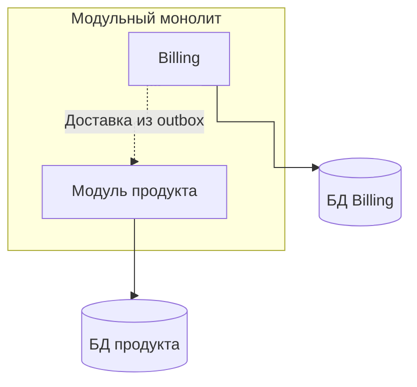

# Модульный монолит с отдельной БД Billing

[Billing](../README.md) → [Развитие](README.md) → Монолит с отдельной БД

Billing остаётся модулем приложения платформы и обновляется при его деплое. Он использует отдельную PostgreSQL БД, пул подключений и роль; данные покупки находятся в БД продукта. Локальный вызов Python между модулями возможен, общей SQL-транзакции между их подключениями нет.

## Границы данных и доставки

Сплошные стрелки показывают SQL-доступ. Пунктир — доставка сохранённого сообщения фоновым relay после commit Billing. Relay вызывает локальную операцию продукта с отдельной UoW; та сохраняет inbox и результат покупки в БД продукта. Подтверждение доставки записывается в Billing только после commit получателя. Подробный [протокол outbox/inbox](../architecture/flows/payment-to-product.md#раздельные-sql-транзакции) общий для монолита и микросервиса.

## Преимущества и ограничения

| Свойство | Возможность и цена |
|---|---|
| Отдельные подключения | У Billing собственные адрес БД, роль и миграции. Требуются настройки, мониторинг и резервное копирование второй БД. |
| Отсутствие прямых SQL-связей с продуктом | Покупка передаётся доверенным снимком, факт оплаты — сообщением. Между БД нет обычных FK; `dblink`/FDW и доступ Billing к таблицам продукта не используются. |
| Раздельное сохранение результатов | Сбой операции продукта не откатывает `PAID`. Возникает задержка предоставления покупки; нужны outbox/inbox, повторы и контроль возраста доставки. |
| Права доступа | Разные роли ограничивают каждое подключение. Общий процесс, имеющий оба секрета, всё ещё может обращаться к обеим БД. |
| Ресурсы и восстановление | БД одного PostgreSQL-кластера делят CPU/I/O, WAL и отказ сервера. Для независимых ресурсов и восстановления на момент времени (PITR) нужен отдельный кластер. |

PostgreSQL допускает [разные права на схемы внутри одной БД](https://www.postgresql.org/docs/current/ddl-schemas.html). Поэтому собственная роль и миграции сами по себе не требуют второй БД. [Восстановление через WAL](https://www.postgresql.org/docs/current/continuous-archiving.html) охватывает кластер целиком; логический дамп одной БД не равнозначен независимому PITR.

## Условия выбора

Вариант можно выбрать до первого платежа, если данные Billing требуется отделить на уровне подключений и запретить прямые SQL-зависимости от продукта. Самостоятельный деплой Billing для этого не нужен. Если требуется запретить процессам платформы доступ к платёжной БД, одной второй БД недостаточно: потребуются отдельные процессы с отдельными правами.

Необходимо согласовать допустимую задержку между `PAID` и результатом покупки. `PAID` и действие `NONE` в API Billing означают принятую оплату без приглашения платить повторно; они не сообщают, что доступ уже открыт. Ожидание предоставления покупки интерфейс показывает по состоянию из API модуля продукта либо из отдельно определённого объединяющего API платформы. При недоступной БД продукта Billing продолжает сохранять проверенную оплату и обязательства доставки. Новые покупки могут зависеть от доступности их снимка; вторая БД не устраняет эту зависимость.

Испытание включает недоступность БД продукта, накопление outbox и последующее восстановление без повторного предоставления покупки. Измеряются возраст доставки и скорость сокращения очереди; при общем кластере также проверяется влияние нагрузки соседней БД. Изолированное восстановление одной стороны требует сверки с другой: общего момента commit нет.

[Перенос данных](migration.md), [нагрузочные проверки](../operations/capacity.md) и [вариант микросервиса](billing-microservice.md) описаны отдельно.
