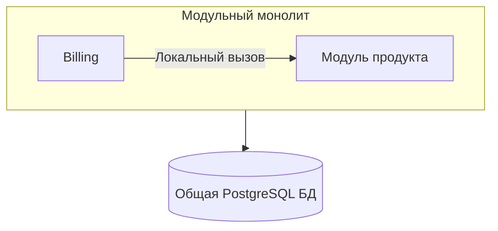

# Модульный монолит с общей БД

[Billing](../README.md) → [Развитие](README.md) → Монолит с общей БД

Billing и модули продукта входят в одно приложение. Изменения Billing развёртываются при деплое новой версии этого приложения. API, Taskiq workers и SQL scanner могут запускаться и перезапускаться отдельными процессами; это не делает их микросервисами. PostgreSQL БД общая, но каждый модуль управляет своими таблицами и миграциями.

## Размещение и транзакция

Рамка показывает одно приложение, стрелка к БД — его SQL-доступ. В фоновом обработчике Billing вызывает операцию модуля продукта, например сохранение права на оплаченный контент. Оплата и это право фиксируются вместе, **если обе операции используют одно соединение и одну SQL-транзакцию**. Само наличие общей БД этого не обеспечивает. Вызовы PSP выполняются за пределами транзакции; HTTP-запрос клиента не ожидает её выполнения.

## Владение данными и доступ

| Граница | Правило |
|---|---|
| Данные Billing | Схема `billing`, собственные ORM-модели и миграции; [таблицы и ограничения](../architecture/persistence.md). |
| Данные продукта | Результат покупки сохраняет операция модуля продукта. Billing не импортирует его ORM-модели и не пишет его таблицы напрямую. |
| Общая транзакция | Возможна, если сохранение оплаты и права на покупку выполняется в одной SQL-транзакции через операцию модуля продукта; [точные условия и последствия сбоя](../architecture/flows/payment-to-product.md#общая-sql-транзакция). |
| Права подключения | Роль worker должна разрешать нужные записи обоих модулей. Для изменения схемы используются отдельные роли миграций. Схема сама по себе не запрещает доступ. |

Если ни одно подключение не должно иметь права записывать оба результата, общий commit не подходит.

## Преимущества и ограничения

Это рекомендуемый запуск: используются существующие приложение, PostgreSQL и Redis/Taskiq; не нужны вторая БД и сетевой контракт между Billing и продуктом. При общей транзакции также не требуется отдельная доставка факта оплаты между модулями.

Цена общей транзакции — зависимость фиксации `PAID` от доступности операции продукта. Все модули делят ресурсы и доступность PostgreSQL. Изменения Billing требуют деплоя приложения платформы.

## Раздельные транзакции в общей БД

Если ошибки предоставления покупки не должны задерживать сохранение оплаты, приложение и БД можно оставить общими, но выбрать раздельные транзакции. Доставка факта оплаты и защита от повторов описаны в [оплате и предоставлении покупки](../architecture/flows/payment-to-product.md#раздельные-sql-транзакции).

Это разделяет повторную обработку оплаты и предоставления покупки, но сохраняет общий отказ PostgreSQL и конкуренцию за его CPU, I/O и соединения. Дополнительные workers помогают только при запасе БД и квоты PSP. Для проверки варианта измеряются задержки SQL, ожидания блокировок и возраст фоновой работы при совместной нагрузке платформы и Billing; [программа испытаний](../operations/capacity.md) описана отдельно.
